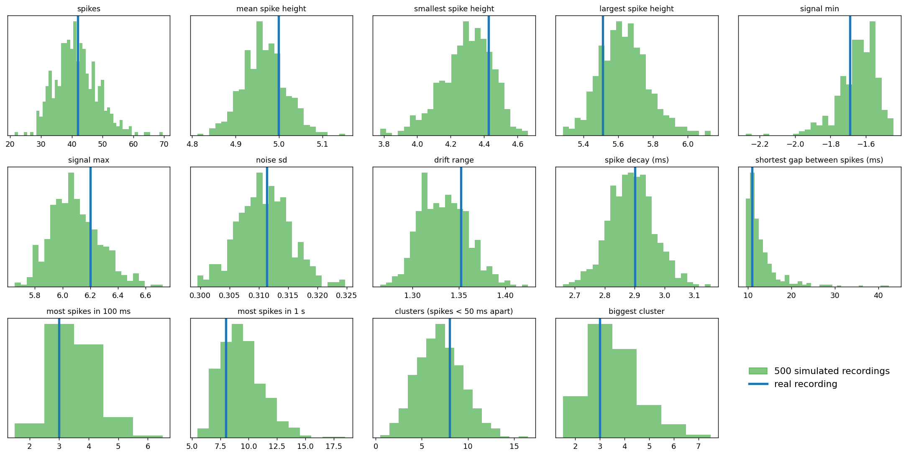

# Reverse engineering the spike recording

**Authors:** Omer Aharonovich, Axel Fridman, Mai Tucker

`spike_data.npz` is 10 s of electrode voltage at 1 kHz. We estimated the model that generates it, wrote a
generator with the same structure, and checked that the same estimation code finds the coefficients again in
the generated data.

**Model.** voltage = slow sine drift + white gaussian noise + spikes. A spike jumps to A in one sample and decays
as exp(-t/tau). The spike times come from a self-exciting poisson process with a 10 ms refractory time: every
spike makes another spike more likely for some tens of ms (`excite`).


## Coefficients

Estimated from the real data, and estimated again with the same code from simulated data.

| coefficient | real data (10 s) | simulated file (10 s) | simulated (10 min) |
|---|---|---|---|
| drift offset | 0.00430 | 0.00650 | 0.00630 |
| drift amplitude | 0.647 | 0.655 | 0.646 |
| drift frequency (Hz) | 0.0908 | 0.0909 | 0.0908 |
| drift phase (rad) | 0.293 | 0.286 | 0.294 |
| noise sd | 0.298 | 0.301 | 0.299 |
| spike rate (Hz) | 4.20 | 4.20 | 4.20 |
| excite (extra spikes per spike) | 0.138 | 0.147 | 0.157 |
| excite_tau (ms) | 27.0 | 24.1 | 27.9 |
| spike amplitude | 4.99 | 4.99 | 4.97 |
| spike amplitude spread | 0.0770 | 0.193 | 0.0932 |
| spike decay (ms) | 2.94 | 2.85 | 2.89 |

The real recording has only 42 spikes, so `excite` and the spike amplitude spread are the least precise values.


## Real vs simulated in numbers

Same spike detector for all. For 14 of the 14 metrics the real recording is inside the range of 95% of 500
simulated recordings (`python -m pytest comparison` checks it).

| metric | real | simulated file | 500 simulations (95% range) |
|---|---|---|---|
| spikes | 42 | 42 | 30 to 56 |
| mean spike height | 5.00 | 5.04 | 4.87 to 5.07 |
| smallest spike height | 4.43 | 4.29 | 3.97 to 4.55 |
| largest spike height | 5.51 | 5.63 | 5.37 to 5.95 |
| signal min | -1.69 | -1.67 | -1.91 to -1.49 |
| signal max | 6.20 | 6.26 | 5.79 to 6.50 |
| noise sd | 0.311 | 0.310 | 0.302 to 0.320 |
| drift range | 1.35 | 1.34 | 1.29 to 1.39 |
| spike decay (ms) | 2.90 | 2.86 | 2.74 to 3.04 |
| shortest gap between spikes (ms) | 11 | 12 | 10 to 24 |
| most spikes in 100 ms | 3 | 5 | 2 to 5 |
| most spikes in 1 s | 8 | 9 | 7 to 14 |
| clusters (spikes < 50 ms apart) | 8 | 8 | 2 to 12 |
| biggest cluster | 3 | 5 | 2 to 6 |



## Files

| file | |
|---|---|
| `spikesim.py` | the model: generator `simulate()` and estimation `estimate()` |
| `spike_simulation.ipynb` | estimation on the real data, checks and all the figures |
| `spike_data.npz` | real recording (`t`, `raw_data`) |
| `simulated_spike_data.npz` | 10 s generated with the estimated coefficients, same format as `spike_data.npz` |
| `simulated_true_spikes.csv` | true spike times of the generated file |
| `coefficients.csv` | the coefficients table |
| `comparison/` | the metrics (`compare.py`), their tests (`test_compare.py`) and `results.csv` |
| `figures/` | figures of the notebook and of `compare.py` |

## Run

```
pip install -r requirements.txt
jupyter notebook spike_simulation.ipynb
python comparison/compare.py
python -m pytest comparison
```

From Python, `simulate(60)` gives 60 s with the estimated coefficients, and any coefficient can be changed:

```python
from spikesim import simulate, estimate
t, x, spikes = simulate(60, rate=10, excite=0)
```
