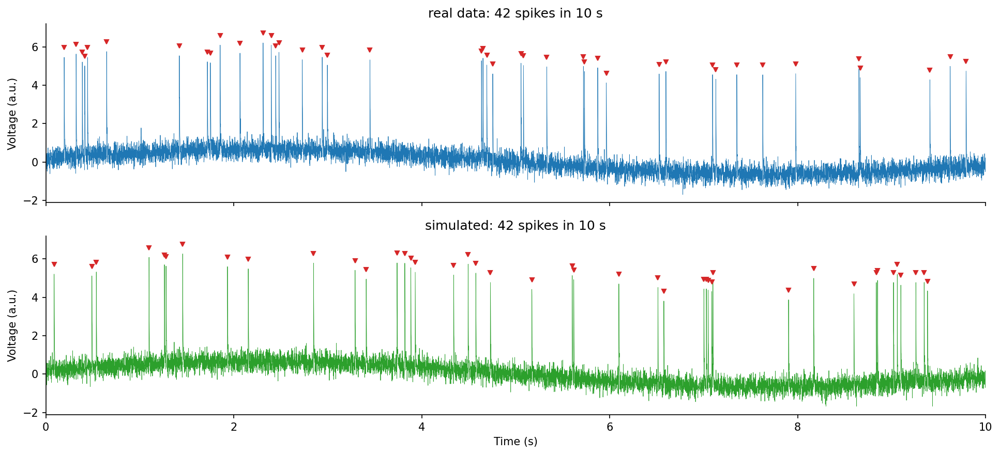
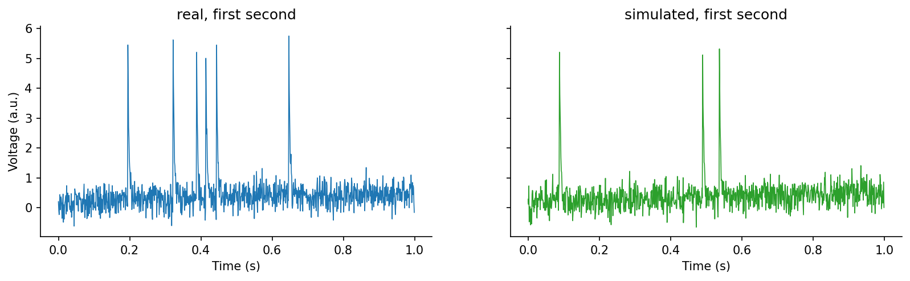
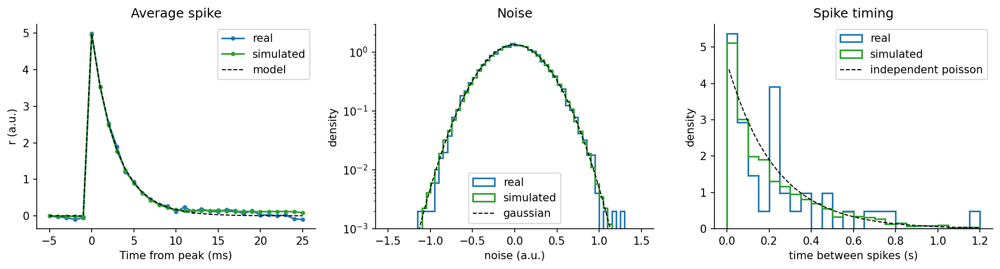
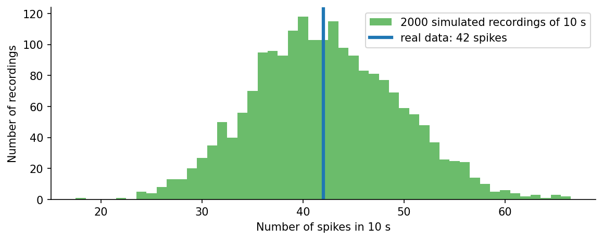

# Reverse engineering the spike recording

**Authors:** Omer Aharonovich, Axel Fridman, Mai Tucker

`spike_data.npz` is 10 s of electrode voltage at 1 kHz. We estimated the model that generates it, wrote a
generator with the same structure, and checked that the same estimation code finds the coefficients again in
the generated data.

**Model.** voltage = slow sine drift + white gaussian noise + spikes. A spike jumps to A in one sample and decays
as exp(-t/tau). The spike times come from a self-exciting poisson process with a 10 ms refractory time: every
spike makes another spike more likely for some tens of ms (`excite`).





## Coefficients

Estimated from the real data, and estimated again with the same code from simulated data.

| coefficient | real data (10 s) | simulated file (10 s) | simulated (10 min) |
|---|---|---|---|
| drift offset | 0.0043 | 0.0065 | 0.0063 |
| drift amplitude | 0.647 | 0.655 | 0.646 |
| drift frequency (Hz) | 0.0908 | 0.0909 | 0.0908 |
| drift phase (rad) | 0.293 | 0.286 | 0.294 |
| noise sd | 0.298 | 0.301 | 0.299 |
| spike rate (Hz) | 4.2 | 4.2 | 4.2 |
| excite (extra spikes per spike) | 0.138 | 0.147 | 0.157 |
| excite_tau (ms) | 27 | 24.1 | 27.9 |
| spike amplitude | 4.99 | 4.99 | 4.97 |
| spike amplitude spread | 0.077 | 0.193 | 0.0932 |
| spike decay (ms) | 2.94 | 2.85 | 2.89 |

The real recording has only 42 spikes, so `excite` and the spike amplitude spread are the least precise values.





## Files

| file | |
|---|---|
| `spike_simulation.ipynb` | estimation, generator and all the figures |
| `spike_data.npz` | real recording (`t`, `raw_data`) |
| `simulated_spike_data.npz` | 10 s generated with the estimated coefficients, same format as `spike_data.npz` |
| `simulated_true_spikes.csv` | true spike times of the generated file |
| `coefficients.csv` | the table above |
| `figures/` | figures saved by the notebook |

## Run

```
pip install -r requirements.txt
jupyter notebook spike_simulation.ipynb
```

In the notebook `simulate(60)` gives 60 s with the estimated coefficients, and any coefficient can be changed,
for example `simulate(60, rate=10, excite=0)`.
